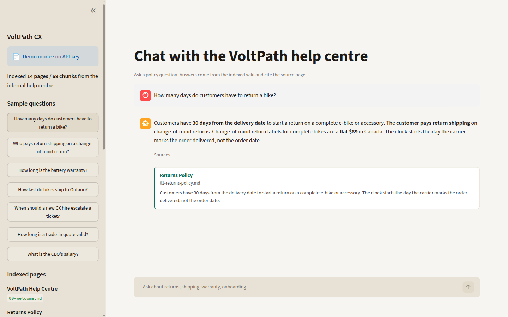
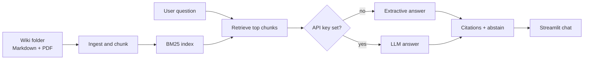

# VoltPath Docs Assistant

Ask the internal help centre a question and get an answer with the source page attached — no API key required.

## The business problem

Support teams still hunt through a wiki (or ping a teammate) while a rider is waiting. The costly answers are the specific ones: return windows, who pays the label, warranty cycle limits, when a new hire must escalate. If the assistant guesses, you get refunds and chargebacks. If it stays silent, the queue stalls.

This project is a small, honest RAG demo of the tool I wanted when I worked in customer success: retrieve the written policy, show the source, and say **I don't know** when the wiki does not cover it.

## What it does

- Ingests a folder of Markdown and PDF pages (a fictional e-bike retailer, VoltPath — 14 help-centre pages).
- Chunks by heading and indexes them with BM25, so it runs locally with no embeddings model and no API key.
- Answers in a Streamlit chat UI and cites the source page under each reply.
- Abstains when retrieval is weak or the question is outside the wiki.
- Optionally calls an OpenAI-compatible API or Gemini when you set a key; demo mode uses extractive sentences from the retrieved chunks.



## Architecture



Demo mode never leaves the machine. LLM mode still answers only from the retrieved chunks; the model is not asked to recall VoltPath from training data.

## Quickstart

```bash
python -m venv .venv && source .venv/bin/activate
pip install -r requirements.txt
streamlit run app.py
```

Open the URL Streamlit prints (usually http://localhost:8501). Try *How many days do customers have to return a bike?* or *What is the CEO's salary?*

Optional LLM mode:

```bash
cp .env.example .env   # then set OPENAI_API_KEY or GEMINI_API_KEY
set -a && source .env && set +a
streamlit run app.py
```

`OPENAI_BASE_URL` is honoured, so any OpenAI-compatible endpoint works.

## Evaluation

```bash
python eval.py
```

Ten golden questions (eight in-wiki, two should abstain). The script prints per-question pass/fail, **answer accuracy**, and **citation hit rate**. CI runs the same command.

```bash
pytest
```

## How I'd take this to production

- Swap BM25 for hybrid search (BM25 + embeddings) once the corpus is larger than a help centre.
- Reindex on publish from the real wiki (Notion, Confluence, or Git) instead of a folder drop.
- Put the assistant behind SSO and log question, retrieved sources, and whether a human edited the draft.
- Start as a draft helper inside the helpdesk, not an auto-send. Low-confidence and abstain answers go to a person.
- Keep a golden set like `evals/questions.json` in CI and fail the build when accuracy or citation hit rate drops.
- Add document-level ACL so a contractor cannot retrieve finance or HR pages.

## Tech stack

| Layer | Choice |
| --- | --- |
| Language | Python 3.12 |
| UI | Streamlit |
| Retrieval | BM25 (`rank-bm25`) |
| Files | Markdown + `pypdf` |
| LLM (optional) | OpenAI-compatible API or Gemini |
| Tests | pytest + a 10-question eval harness |
| CI | GitHub Actions |

Sample data lives in `data/wiki/`. It is fictional. There are no real customers, tickets, or keys in this repo.

## Project layout

```
app.py                 Streamlit chat
eval.py                Golden-question scorer
docs_chat/             Ingest, BM25, extractive + LLM answers
data/wiki/             Fake VoltPath help centre
evals/questions.json   Ten scored questions
tests/                 Unit tests for ingest, retrieval, abstain
```

Built by [Stefan Istoc](https://github.com/stefandevelops).
